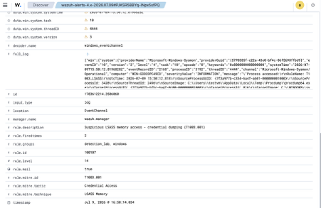
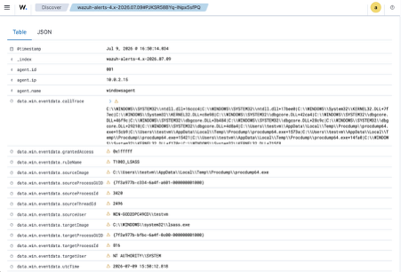

# Investigation: LSASS Memory Access — Credential Dumping (T1003.001)

Live detection captured in the lab on 2026-07-09. The headline detection of the
lab. Getting it to fire required tuning Sysmon — see
[Detection Engineering Notes](../docs/06-detection-engineering-notes.md).

## Alert
- **Rule:** Wazuh 100107 / Sigma `win_lsass_memory_access.yml`
- **ATT&CK:** T1003.001 LSASS Memory (Credential Access)
- **Severity:** level 14 (High)
- **Host:** WIN-GOD2DPC49CD (agent 001, `windowsagent`)
- **Fired at:** 2026-07-09 16:50 (local)



## What triggered it
Sysmon Event ID 10 (ProcessAccess): a process opened a handle to
`lsass.exe` with `GrantedAccess: 0x1FFFFF` (PROCESS_ALL_ACCESS) — the access
level needed to read process memory. Reproduced with procdump:

```powershell
procdump64.exe -accepteula -ma lsass.exe lsass.dmp
```

Key fields:

```
rule.id           100107
rule.level        14
rule.description  Suspicious LSASS memory access - credential dumping (T1003.001)
rule.mitre.id     T1003.001
data.win.eventdata.targetImage     C:\WINDOWS\system32\lsass.exe
data.win.eventdata.grantedAccess   0x1fffff
data.win.eventdata.ruleName        T1003_LSASS
CallTrace                          ...\ntdll.dll+...  (memory read path)
```



## Why it matters
`lsass.exe` holds credential material (hashes, tickets, sometimes plaintext).
Dumping its memory (Mimikatz, procdump, comsvcs MiniDump) is the standard route
to credential theft and lateral movement. The rule matches high-access handle
opens (`0x1010` / `0x1410` / `0x1fffff`) against lsass, which is the behaviour
common to all of those tools regardless of the binary used.

## Defense-in-depth observed
During the lab, **Microsoft Defender independently caught and quarantined**
both the procdump binary (`HackTool:Win32/DumpLsass`) and the Task Manager dump
attempt (`Behavior:Win32/DumpLsass`). So two controls fired on the same
activity: Defender blocked it, and the Sysmon→Wazuh pipeline detected it. To
capture the Sysmon telemetry cleanly, Defender real-time protection and LSA
protection (RunAsPPL) were disabled for the test — simulating an attacker who
has already tampered with those controls.

## Verdict
**True positive.** A full-access handle to lsass was opened and dumped,
consistent with credential theft.

## Response
Treat as a high-severity credential-access event: isolate the host, force-reset
credentials that could have been in memory (especially any privileged/cached
accounts), preserve the dump artefact, and hunt for lateral movement using the
stolen material.

## Tuning
Some legitimate tools touch lsass (AV, EDR, backup agents). Baseline those
specific source images into an exclusion rather than dropping severity — a
handle open to lsass with `0x1fffff` from an unexpected process should stay
loud.
