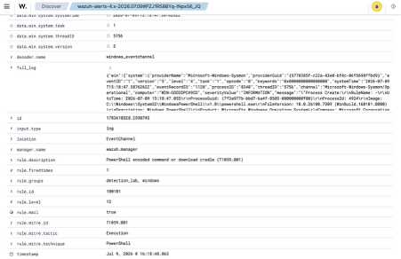
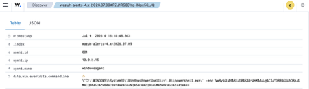

# Investigation: PowerShell Encoded Command (T1059.001)

Live detection captured in the lab on 2026-07-09.

## Alert
- **Rule:** Wazuh 100101 / Sigma `win_powershell_encoded_command.yml`
- **ATT&CK:** T1059.001 PowerShell (Execution)
- **Severity:** level 12 (High)
- **Host:** WIN-GOD2DPC49CD (agent 001, `windowsagent`)
- **Fired at:** 2026-07-09 15:18:47 UTC



## What triggered it
Sysmon Event ID 1 (process creation): `powershell.exe` launched with an
`-enc` argument. The rule matched the encoded-command / download-cradle pattern
on the command line:

```
"C:\WINDOWS\System32\WindowsPowerShell\v1.0\powershell.exe" -enc VwByAGkAdABlAC0ASABvAHMAdAAgACIAYQB0AG8AbQBpAGMALQB0AGUAcwB0AC0AVAAxADAANQA5AC0AZQBuAGMAbwBkAGUAZAAiAA==
```



Key fields from the alert:

```
rule.id           100101
rule.level        12
rule.description  PowerShell encoded command or download cradle (T1059.001)
rule.mitre.id     T1059.001
data.win.eventdata.image           ...\v1.0\powershell.exe
data.win.eventdata.parentImage     ...\v1.0\powershell.exe
data.win.eventdata.integrityLevel  High
data.win.eventdata.user            WIN-GOD2DPC49CD\testvm
```

## Triage: is it malicious?
- **Decode the blob.** `[Convert]::FromBase64String(...)` interpreted as
  UTF-16LE decodes to `Write-Host "atomic-test-T1059-encoded"`. In this lab
  it's a benign Atomic-style test string, but the *technique* — passing an
  encoded blob to `-enc` to hide intent — is what the rule flags.
- **Why analysts care:** attackers Base64-encode PowerShell to evade
  command-line inspection and AV string matching. A real cradle in that blob
  would typically be `Net.WebClient` / `DownloadString` pulling a payload.
- **Integrity level High** means it ran elevated — worth noting for scope.

## Verdict
**True positive** for the detection logic. Encoded PowerShell execution was
observed and alerted on within seconds of running.

## Response
In a real incident: capture the full process tree, decode and preserve the
blob, check for a following outbound connection (Sysmon Event ID 3, see
rule 100110), and isolate the host if the decode reveals a download-execute.

## Tuning
Some legitimate installers and management tooling (SCCM, vendor agents) use
`-EncodedCommand`. Rather than lowering severity, baseline known-good parent
processes / admin hosts into a filter so operator-driven encoded commands don't
bury genuine user-context hits.
