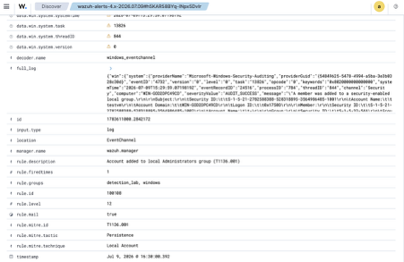
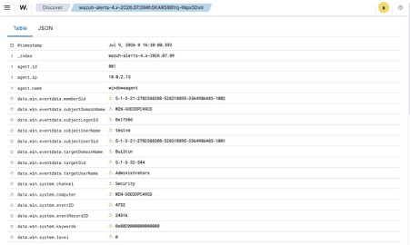

# Investigation: New Local Administrator Account (T1136.001)

Live detection captured in the lab on 2026-07-09. This one also exposed a real
rule bug — see [Detection Engineering Notes](../docs/06-detection-engineering-notes.md).

## Alert
- **Rule:** Wazuh 100108 / Sigma `win_new_local_admin.yml`
- **ATT&CK:** T1136.001 Local Account (Persistence)
- **Severity:** level 12 (High)
- **Host:** WIN-GOD2DPC49CD (agent 001, `windowsagent`)
- **Fired at:** 2026-07-09 16:24 (local)



## What triggered it
Windows Security Event ID 4732 ("a member was added to a security-enabled local
group"), where the target group SID is `S-1-5-32-544` (the built-in
Administrators group). Reproduced with:

```cmd
net user hacker P@ssw0rd123! /add
net localgroup Administrators hacker /add
```

Key fields:

```
rule.id           100108
rule.level        12
rule.description  Account added to local Administrators group (T1136.001)
rule.mitre.id     T1136.001
Event ID          4732
Member added      hacker
Group SID         S-1-5-32-544 (Administrators)
Subject           WIN-GOD2DPC49CD\testvm
```



## Why it matters
Adding a new account to local Administrators is a classic persistence /
privilege move — it survives password resets of other accounts and gives the
attacker a durable foothold. Keying on the group **SID** (`S-1-5-32-544`)
rather than the name "Administrators" makes the detection locale-independent
(the group is renamed in non-English Windows).

## Note: audit policy prerequisite
4732 only logs if the **Security Group Management** audit subcategory is
enabled. During the lab this was initially off and the event never generated
until:

```cmd
auditpol /set /subcategory:"Security Group Management" /success:enable
```

A silent detection because of a missing audit policy is itself a lesson: the
rule is only as good as the telemetry feeding it.

## Verdict
**True positive.** A new account was created and elevated to local admin, and
the alert fired on the group-membership change.

## Response
Confirm the account is unauthorised, disable/remove it, hunt for how it was
created (parent process, logon session), and review other hosts for the same
account name. Rule 100108 is also wired to the automated active response in
`docs/04-active-response.md`, which disables the rogue account on detection.
